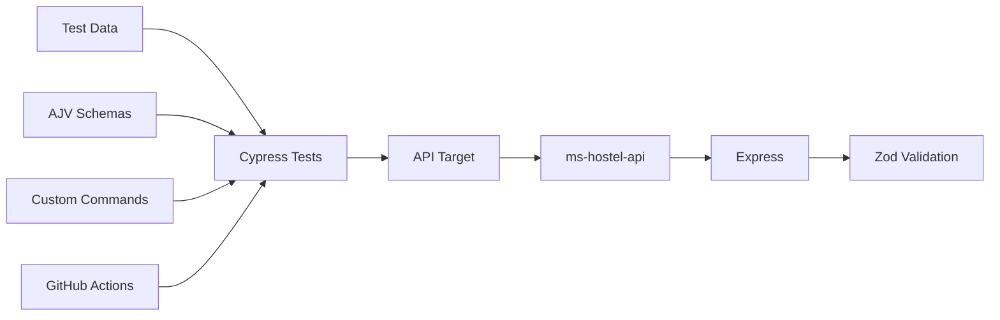

# API Testing Framework
[](https://github.com/lediosax5/api-testing-framework/actions/workflows/api-tests.yml)

Framework de **automatización de pruebas de API** construido con Cypress y JavaScript, pensado como base reutilizable para automatizar APIs y microservicios.

El proyecto cubre validaciones funcionales, contratos de respuesta, escenarios positivos y negativos, manejo de datos de prueba, reportes y ejecución automática en CI.

## Stack

**JavaScript (CommonJS) · Node.js · Cypress · AJV · Express · Zod · OpenAPI · GitHub Actions**

- Node.js para ejecutar la API mock directamente.
- Cypress para ejecución de API tests.
- AJV + JSON Schema para validar response contracts.
- Express + Zod para una API mock determinística.
- OpenAPI / Swagger para documentar el servicio bajo prueba.
- Mochawesome + terminal logs para evidencia de ejecución.
- Fixture-based test data separado de la lógica de los tests.
- GitHub Actions para CI.

## Architecture



Cypress mantiene separados los **test cases**, los datos de prueba y los contratos esperados.

El `ms-hostel-api` funciona como API de referencia local y permite ejecutar la suite de manera determinística sin depender de servicios externos.

## Project structure

```text
cypress/
├── e2e/apis/          # Specs .cy.js organizadas por API y recurso
├── fixtures/          # Test data
├── schemas/           # Response contracts
└── support/           # Configuración de soporte, comandos y evidencia HTTP

mock-server/
├── src/               # Express API
└── openapi/           # OpenAPI specification

.github/workflows/     # GitHub Actions
cypress.config.js       # URL de la API, specs y reportes
```

## Current coverage

La suite actual contiene **56 automated API tests** sobre `ms-hostel-api`.

| Endpoint | Coverage |
| --- | --- |
| `GET /health` | Health check |
| `GET /api/v1/users` | Listado, filtros, búsqueda, sorting y pagination |
| `POST /api/v1/users` | Creación y validaciones |
| `GET /api/v1/users/{id}` | Consulta por ID |
| `PUT /api/v1/users/{id}` | Full update |
| `PATCH /api/v1/users/{id}` | Partial update |
| `DELETE /api/v1/users/{id}` | Eliminación |

Incluye escenarios **positive / negative**, status codes, response body, business rules y contract validation.

Con la API mock ejecutándose, la documentación Swagger está disponible en:

[http://localhost:3000/docs](http://localhost:3000/docs)

## Run locally

Requiere **Node.js 24.x** y **Google Chrome** para la ejecución por consola.

```bash
npm ci
```

Iniciá la API mock.

```bash
npm run mock:start
```

En otra terminal, ejecutá la suite.

```bash
npm run cy:run
```

`npm test` ejecuta la misma suite. Para usar el modo interactivo, abrí Cypress.

```bash
npm run cy:open
```

Usá `npm run mock:dev` para reiniciar la API automáticamente cuando cambian sus archivos JavaScript. La API y Cypress usan el puerto `3000` por defecto. Podés configurar `PORT` en ambas terminales para usar otro puerto o apuntar Cypress a una API compatible mediante `API_BASE_URL`.

La spec `reset-test-data.cy.js` está disponible en modo interactivo para restaurar los datos iniciales de la API mock.

## CI & Evidence

Cada `push` y `pull_request` ejecuta automáticamente:

```text
npm ci
→ Start mock API
→ Health check
→ Cypress API tests
→ Upload artifacts
```

GitHub Actions conserva como artifact:

```text
api-test-artifacts
```

incluyendo el **Mochawesome HTML report**, terminal logs y screenshots cuando existen.

## Design approach

El framework busca mantener una separación clara entre:

**test logic → test data → contracts → API implementation**

Los test cases data-driven reutilizan fixtures mediante `Cypress._.each`, evitando duplicar lógica entre escenarios.

Los contratos utilizados por Cypress son independientes de las validaciones Zod del mock, evitando validar una implementación contra su propia definición.

La estructura está preparada para incorporar nuevos microservices, resources y endpoints sin cambiar la arquitectura base.
